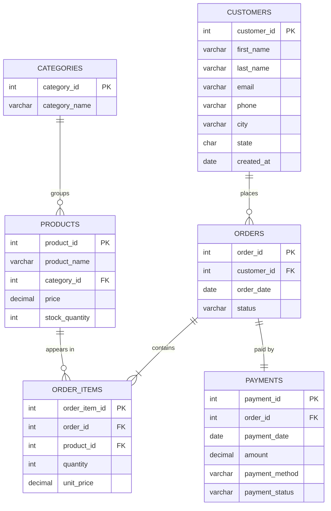

# 🛒 Online Shopping Management System (SQL Project)

A beginner-friendly **MySQL** project that builds a relational database for an online store and uses SQL to manage **customers, products, orders, and payments**, then turns the data into **business reports**.

Built to practice the core skills used by **SQL Developers, Database Developers, and Data Analysts**.

---

## 📌 Project Objective

Design and query a database that answers real business questions:

- What are our **total sales**?
- Which products are the **best sellers**?
- Who are our **top customers**?
- How do sales change **month to month**?
- Which products need **restocking**?

---

## 🧠 Skills Demonstrated

| Skill | Where |
|---|---|
| Create databases, tables, primary & foreign keys, constraints, indexes | `01_create_tables.sql` |
| Insert data (including `INSERT ... SELECT`) | `02_insert_data.sql` |
| `SELECT`, `WHERE`, `ORDER BY`, `LIMIT`, `LIKE`, `BETWEEN` | `03_basic_queries.sql` |
| `UPDATE`, `DELETE`, transactions (`START TRANSACTION` / `COMMIT`) | `03_basic_queries.sql` |
| `INNER JOIN`, `LEFT JOIN`, joins across 4 tables | `04_joins.sql` |
| `SUM`, `COUNT`, `AVG`, `GROUP BY`, `HAVING`, subqueries, `CASE` | `05_sales_reports.sql` |
| CTEs (`WITH`) and window functions (`RANK`, running totals) | `05_sales_reports.sql` |
| Views and stored procedures | `06_views_and_procedures.sql` |

---

## 🗂️ Database Design (ER Diagram)



### Tables

| Table | What it stores | Rows |
|---|---|---|
| `customers` | Shopper name, email, phone, location | 15 |
| `categories` | Product groups (Electronics, Books, ...) | 5 |
| `products` | Item name, price, stock | 20 |
| `orders` | One row per checkout, with status | 25 |
| `order_items` | Products inside each order (quantity, price paid) | 48 |
| `payments` | Amount, method, and status for each order | 25 |

**Why `order_items`?** One order can have many products, and one product can be in many orders. The `order_items` table connects them (a *many-to-many* relationship). It also saves the `unit_price` at checkout, so old orders stay correct if a price changes later.

---

## 📁 Project Structure

```
online-shopping-management-system/
├── README.md
└── sql/
    ├── 01_create_tables.sql          # database + 6 tables
    ├── 02_insert_data.sql            # sample data
    ├── 03_basic_queries.sql          # SELECT, UPDATE, DELETE
    ├── 04_joins.sql                  # INNER JOIN, LEFT JOIN
    ├── 05_sales_reports.sql          # 16 business reports
    └── 06_views_and_procedures.sql   # views + stored procedure
```

---

## ▶️ How to Run

**Requirements:** MySQL 8.0+ (or MariaDB 10.5+). Any tool works: MySQL Workbench, DBeaver, or the command line.

### Option A: MySQL Workbench
1. Open each file in the `sql/` folder **in order** (01 → 06).
2. Click the ⚡ lightning bolt to run the whole file.

### Option B: Command line
```bash
git clone https://github.com/<your-username>/online-shopping-management-system.git
cd online-shopping-management-system/sql

mysql -u root -p < 01_create_tables.sql
mysql -u root -p < 02_insert_data.sql
mysql -u root -p online_shop < 05_sales_reports.sql
```

> File 01 drops and rebuilds the `online_shop` database, so you can reset everything anytime.
> Run **01 then 02** first. Files 03–06 can be run after that. (File 03 changes some prices, so run 05 before 03 if you want to match the results below exactly.)

---

## 📊 Sample Results

> Business rule: **cancelled orders are not counted as sales.**

### Store summary
| total_orders | items_sold | total_revenue | avg_order_value |
|---|---|---|---|
| 23 | 65 | **$2,888.35** | $125.58 |

### Top 5 best-selling products (by units)
| product_name | units_sold | revenue |
|---|---|---|
| Classic T-Shirt | 11 | $164.89 |
| Water Bottle 32oz | 8 | $159.92 |
| Wireless Earbuds | 6 | $359.94 |
| USB-C Charger 65W | 5 | $149.95 |
| SQL for Beginners | 5 | $139.95 |

### Sales by category
| category_name | units_sold | revenue |
|---|---|---|
| Electronics | 17 | $1,209.83 |
| Home & Kitchen | 10 | $599.90 |
| Clothing | 17 | $434.83 |
| Sports & Outdoors | 12 | $387.88 |
| Books | 9 | $255.91 |

### Monthly sales
| sales_month | orders | revenue |
|---|---|---|
| 2026-01 | 4 | $570.89 |
| 2026-02 | 3 | $375.92 |
| 2026-03 | 4 | $560.87 |
| 2026-04 | 3 | $359.90 |
| 2026-05 | 2 | $305.96 |
| 2026-06 | 3 | $336.91 |
| 2026-07 | 4 | $377.90 |

### Top customers
| customer_name | city | orders | total_spent |
|---|---|---|---|
| James Carter | Philadelphia | 3 | $609.92 |
| Maria Lopez | Philadelphia | 4 | $410.90 |
| Daniel Kim | Pittsburgh | 2 | $249.94 |
| Emily Nguyen | New York | 2 | $230.94 |
| Omar Hassan | Chester | 1 | $219.99 |

### Payment status
| payment_status | payments | amount |
|---|---|---|
| Completed | 20 | $2,620.42 |
| Pending | 3 | $267.93 |
| Refunded | 2 | $214.98 |

---

## 📈 Reports Included (`05_sales_reports.sql`)

1. Total store sales
2. Store summary (orders, items, revenue, average order value)
3. Top 5 best-selling products by units
4. Top 5 products by revenue
5. Sales by category
6. Monthly sales report
7. Top 5 customers by money spent
8. Repeat customers (`HAVING`)
9. Sales by state
10. Revenue by payment method
11. Payment status summary
12. Orders above the average order value (subquery)
13. Customer segments: VIP / Regular / New / Inactive (`CASE`)
14. Inventory value by category
15. Best-selling product in each category (CTE + `RANK()`)
16. Running revenue total by month (window function)

---

## 💡 Key Insights from the Data

- **Electronics** brings in the most money (about 42% of revenue), even though Clothing sells the same number of units.
- **Classic T-Shirt** sells the most units, but the **27-inch Monitor** earns the most revenue.
- **Pennsylvania** customers make up about two-thirds of all sales.
- **3 customers** have no completed orders, so they are good targets for a win-back email.
- **Camping Tent** has never sold and was out of stock, so it needs restocking.

---

## 🔮 Future Improvements

- Add a `reviews` table for product ratings
- Add a `shipping` table with carriers and tracking numbers
- Add a trigger that lowers `stock_quantity` automatically when an order is placed
- Connect the database to a Power BI or Tableau dashboard

---

## 👤 Author

**Jay Patel**: IT Support Specialist building SQL and data skills.
CompTIA Security+ · Cisco CCST · Microsoft Azure Fundamentals
